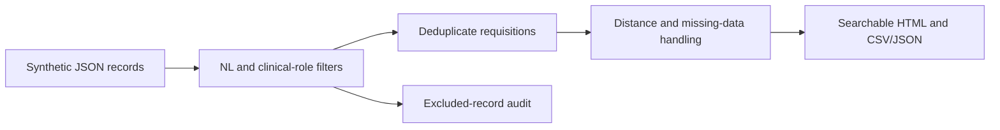

> **Proprietary - All Rights Reserved.** Licensed to Sandeep Grover. No reuse, copying, modification, or distribution without prior written permission. See LICENSE.

# Netherlands clinical-job dashboard demonstration

A small, runnable **offline, deterministic demonstration** of location and role filtering,
requisition deduplication, straight-line distance from Leiden, source preservation, and
HTML/CSV/JSON reporting. All companies, vacancies, benefits and office coordinates in
the fixture are illustrative. This is a newly prepared portfolio sample, not delivered
client work and not a live job board or AI agent.



## Run locally

Python 3.10+; no third-party runtime dependencies, API keys or network requests.
The commands below are instructions for an authorized evaluation; public visibility
does not grant reuse rights under the accompanying licence.

```bash
python main.py --dry-run
python main.py --output output
python -m unittest -v test_clinical_jobs.py
```

Open `output/report.html`. Its search field filters the displayed sample rows.
`output/jobs.csv` and `output/jobs.json` retain provenance and missing-data labels.
The six supplied records produce three unique matching roles and three audit exclusions.
Outputs are written atomically and repeated runs are deterministic.

## What the implementation verifies

- Netherlands-only records from explicitly supplied pharma/biotech sector labels.
- Transparent clinical-role keyword rules, not claims of semantic AI classification.
- Requisition deduplication while retaining identifying URL query parameters.
- Haversine distances in kilometres from Leiden city centre; missing coordinates stay unknown.
- Benefits are copied from the supplied record or marked “Not stated”.
- HTML escaping, HTTP(S)-only source links and spreadsheet formula protection.
- Tests for inclusion/exclusion, deduplication, distance, missing data and output injection.

## Production scope still to build

This demo does **not** scrape LinkedIn, fetch company websites, infer benefits, geocode
addresses, verify whether a vacancy is live, or install a daily scheduler. A production
engagement first agrees the company/source list and access routes, then adds source
adapters, timestamped collection/error logs, validation against source text, and a
client-approved hosting schedule. AI-assisted extraction would need its own labelled
evaluation and explicit unknown/uncertain handling. Driving distance requires a routing
provider and is distinct from the straight-line distance demonstrated here.

No client data, private application history, credentials or personal contact details
are included. Source links use reserved `.example` domains.
